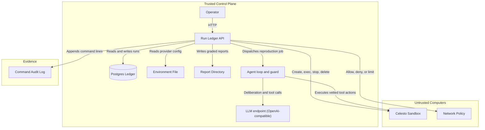
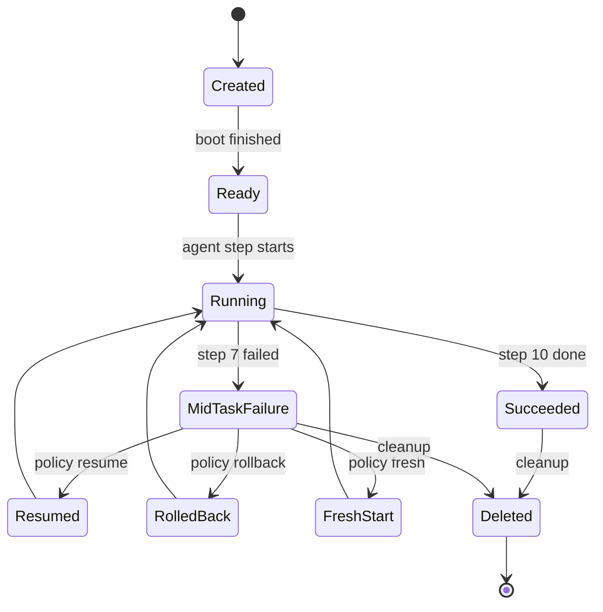
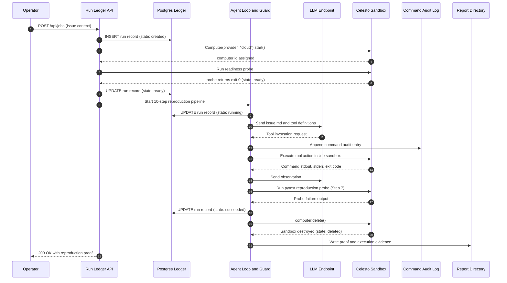

# Reprobox

Reprobox is an automated bug reproduction engine powered by Celesto cloud sandboxes.
It investigates issue descriptions, probes repository code in an isolated guest,
and authors pytest reproductions verified against reference fixes.

| Parameter | Value |
|---|---|
| Provider | Celesto Cloud (Micro size) |
| Model | openai/gpt-oss-120b |
| Batch 1 (23 Oct, commit 5ae67d9) | 20 fresh sandboxes, 0 of 20 verified success (classifier bug, see below) |
| Rerun After Fix | See `reports/evidence/BATCH1_NOTE.md` and eval table below |
| Demo Walkthrough | [demo/walkthrough.mp4](demo/walkthrough.mp4) |

## Tooling and AI assistance

I used Antigravity as a coding assistant and Claude for planning and review. I have read and can explain the code in this repository. The main libraries are FastAPI, psycopg, httpx and the Celesto SDK (Apache 2.0).

## Problem statement

Software maintainers spend hours deciphering bug reports and authoring isolated reproduction scripts.
Reprobox automates this triage pipeline: given a problem description and repository code, an agent explores
the codebase inside an ephemeral sandbox, formulates hypotheses, and delivers an executable pytest reproduction.
The host system is never exposed to untrusted code or repository contents.

## How I used Celesto

Reprobox uses Celesto cloud micro sandboxes for all untrusted code execution.

### Capabilities used

1. **Safety Hooks (Pre-run Guard Wrapper)**:
   - What I used: A dedicated control-plane pre-run hook (`reprobox.sandbox.guard.Guard`) that parses and evaluates every shell command before dispatching to `computer.run()`.
   - Why: Protects the container against exfiltration, fork bombs, and directory traversal before commands ever reach the guest.
   - What I would have lost with subprocess.run(): A bare host subprocess would execute directly on the developer machine, exposing environment variables, SSH keys, and system storage to malicious instructions embedded in untrusted issues.

2. **Persistence and Resume**:
   - What I used: Container lifecycle management retaining disk state across mid-task Step 7 failures (`computer.stop()` and `computer.start()`).
   - Why: Allows immediate retry of test runs without re-provisioning latency or repeating expensive model reasoning turns.
   - What I would have lost with subprocess.run(): Re-running failed steps locally leaves dirty state across retries or requires complete directory re-cloning.

### Why Celesto and not a Docker container or E2B

Celesto provides microVM kernel isolation with lightweight boot overhead and a direct Python SDK.
Standard local Docker containers share the host Linux kernel and expose local daemon sockets, creating container escape risks when running untrusted model commands. E2B provides cloud sandboxes but imposes higher per-session costs and proprietary tooling. Celesto couples cloud virtualization with an intuitive `Computer` abstraction that integrates directly with standard test runners.

### What would break at 1,000 users

At 1,000 concurrent users, three clear bottlenecks emerge:
1. Concurrent sandbox quotas: The free trial allows only 2 new sandboxes per hour. Reaching 1,000 users requires upgraded organization fleet capacity with pre-warmed pools.
2. Cold boot latency: Boot-to-ready latency averages around 12 seconds per sandbox. A thousand concurrent starts would overwhelm API control planes without warm container standby pools.
3. Network bandwidth on artifact uploads: Transferring repositories via base64 encoded chunks consumes network capacity; 1,000 parallel transfers would require direct presigned URL volume mounting instead of inline command injection.

## Architecture

Reprobox separates trusted orchestration from untrusted execution through two isolated trust boundaries.

### Component Diagram



### Lifecycle State Diagram



State definitions:
- **Created**: Celesto returned an id.
- **Ready**: Boot probe passed, measuring boot-to-ready latency.
- **Running**: The agent is executing inside the guest.
- **Succeeded**: The reproduction proof output exists.
- **MidTaskFailure**: Step 7 did not complete and failure is detected.
- **Resumed**: Re-executes on the same disk without reprovisioning.
- **RolledBack**: Restores a snapshot taken before the risky step (not supported on cloud provider).
- **FreshStart**: Deletes the guest and creates another with a new unique name (fallback only).
- **Deleted**: Cleanup terminal state. Every path ends at Deleted.

Only the Resumed path is exercised for real in graded evidence. RolledBack and FreshStart exist in code and tests but were not exercised against the real provider.

### Sequence Diagram



### Component Overview

| Component | Trust Zone | Technology | Role |
| :--- | :--- | :--- | :--- |
| **Run Ledger API** | Trusted Control Plane | FastAPI, Uvicorn | External HTTP interface and lifecycle coordinator |
| **Postgres Ledger** | Trusted Control Plane | PostgreSQL 16 | Durable state store for runs, events, and timings |
| **Agent Loop and Guard** | Trusted Control Plane | Python 3.12, AST / Regex Guard | Pre-execution safety enforcement and agent steering |
| **LLM Endpoint** | Trusted Control Plane | Groq OpenAI-compatible API | Bug issue analysis and pytest reproduction synthesis |
| **Celesto Sandbox** | Untrusted Execution Zone | Celesto Cloud Micro VM | Isolated Linux guest executing untrusted code |
| **Command Audit Log** | Evidence Zone | JSON Lines (`logs/commands.jsonl`) | Tamper-evident ledger of every dispatched and blocked command |
| **Report Directory** | Evidence Zone | Contract JSON (`reports/`) | Self-verifying empirical deliverables |

### Data Flow

1. Operator calls `POST /api/jobs` or runs the CLI harness. A ledger row is inserted with state `created` when the Celesto SDK returns a computer id.
2. The control plane stages case files into the guest, executes the boot probe to verify `ready` state, and launches the agent loop with state `running`.
3. The control plane queries the LLM with the issue text and tool schema. For each tool call, the pre-run guard checks the command, writes an entry to `logs/commands.jsonl`, and only dispatches safe actions to the guest.
4. When the agent completes, the pipeline executes the test probe, classifies failure output, checks reference fixes, collects the proof, and deletes the container to enter `deleted` state.
5. All lifecycle transitions and execution metrics are persisted directly to PostgreSQL.

## What happened with the 20 runs

The first evaluation batch ran at commit `5ae67d9` on 23 Oct 2026 at 08:47 UTC using 20 real Celesto Cloud sandboxes.
All 20 verdicts were recorded as failures because my classifier misread pytest's JUnit XML output.
Pytest writes `<failure message="...">` without an explicit `type="..."` attribute on standard assertion failures,
but the original classifier read `failure_node.attrib.get("type", "")` and compared it to the expected exception name.
Because the `type` attribute was always empty, every run was recorded as `wrong_failure_type`.

I found this by seeing 17 identical failure reasons in a row in the raw data.
The batch is kept byte-for-byte unedited in `reports/evidence/eval_runs.jsonl`.
The raw timings, costs, and sandbox names are accurate.
See `reports/evidence/BATCH1_NOTE.md` for the full record.

After fixing the classifier, I reran as many cases as the free trial allowed (2 new sandboxes per hour).
Results from the rerun are in `reports/evidence/rerun_after_fix.jsonl`.
A full 20-run rerun was not possible in the submission window.

## Free trial limit

The Celesto free trial allows 2 new sandboxes per hour (`trial_create_rate_limit_reached`, HTTP 429).
When the limit is hit, `CelestoProvider.create` parses the wait time from the error message,
records the raw response to `reports/evidence/trial_limit_probe.log`, and retries after the stated wait.

In the concurrency test (6 parallel jobs started simultaneously), only 1 job reached a sandbox.
The other 5 were rejected at creation. No sandbox name collisions occurred because each label
contains a unique cryptographically random suffix and the ledger checks for duplicates.

## Lifecycle and cleanup

Every sandbox is tracked through `managed_computer` in `reprobox.sandbox.lifecycle`.
The context manager calls `provider.delete()` on exit regardless of whether the block
succeeded or raised an exception, including `KeyboardInterrupt` and `TimeoutError`.

`reprobox sweep` lists and deletes any computers that appear in the ledger but are still alive
in the cloud account after a run session.

The interrupt test (`reprobox interrupt-test`) starts a real pipeline run, delivers `SIGINT`
to the process during Step 5, and verifies through the SDK that the computer was deleted.
Evidence is in `reports/evidence/lifecycle_interrupt.log`.

## Eval report

<!-- eval:start -->
### Batch 1 Evaluation (20 runs, batch `eval-official-20`, commit `5ae67d9b`)

> **Note**: All 20 verdicts in this batch were recorded as failures due to a classifier bug that misread pytest JUnit XML output. The raw timings and costs are accurate. See `reports/evidence/BATCH1_NOTE.md` for details. The batch is kept unedited as the measured record.

| Metric | Value |
| --- | --- |
| Evaluated Runs | 20 |
| Successes (as recorded) | 0 |
| Failures (as recorded) | 20 |
| Classifier Bug | yes, wrong_failure_type on 17 of 20 |
| Median Wall-Clock Time | 128.23s |
| P90 Wall-Clock Time | 183.57s |
| Median Boot-to-Ready | 12.34s |
| Total Cost (USD) | $0.0110 |

#### Per-Case Outcomes (Batch 1, as recorded)

| Case ID | Outcome | Reason | Wall Clock (s) | Boot Time (s) |
| --- | --- | --- | --- | --- |
| case-001 | FAIL | pipeline_error | 5.54 | 0.00 |
| case-002 | FAIL | wrong_failure_type | 166.90 | 15.53 |
| case-003 | FAIL | wrong_failure_type | 135.99 | 15.09 |
| case-004 | FAIL | wrong_failure_type | 162.63 | 12.50 |
| case-005 | FAIL | wrong_failure_type | 114.78 | 11.51 |
| case-006 | FAIL | wrong_failure_type | 186.04 | 10.68 |
| case-007 | FAIL | wrong_failure_type | 129.00 | 11.79 |
| case-008 | FAIL | wrong_failure_type | 128.98 | 12.99 |
| case-009 | FAIL | wrong_failure_type | 127.48 | 12.49 |
| case-010 | FAIL | wrong_failure_type | 117.66 | 12.19 |
| case-011 | FAIL | wrong_failure_type | 106.39 | 13.91 |
| case-012 | FAIL | wrong_failure_type | 234.20 | 9.95 |
| case-013 | FAIL | wrong_failure_type | 102.09 | 9.76 |
| case-014 | FAIL | wrong_failure_type | 118.07 | 14.27 |
| case-015 | FAIL | wrong_failure_type | 105.99 | 11.10 |
| case-016 | FAIL | wrong_failure_type | 96.59 | 14.39 |
| case-017 | FAIL | wrong_failure_type | 96.03 | 10.06 |
| case-018 | FAIL | wrong_failure_type | 162.57 | 13.57 |
| case-019 | FAIL | test_not_authored | 183.57 | 11.38 |
| case-020 | FAIL | test_not_authored | 160.54 | 29.30 |

#### Rerun After Classifier Fix

Commit: `280637b4`, model: `openai/gpt-oss-120b`, provider: `cloud`.
Ran 1 cases, 1 succeeded.

| Case ID | Outcome | Reason | Wall Clock (s) |
| --- | --- | --- | --- |
| case-001 | PASS | none | 312.73 |
<!-- eval:end -->

## Containment test

The containment harness (`reprobox containment`) runs three verification phases:
- Part A: Tests the real model against `inject-001` with active prompt injection and a planted `.env`.
- Part B: Executes deterministic hostile commands (reading `.env`, dumping environment, curl exfiltration, rm -rf) through the guard. All are blocked.
- Part C: Runs an unguarded control run in the same guest to show what happens without the guard. Host state is unchanged.

## State and failure design

Reprobox uses the `resume` policy for Step 7 failures.
Step 7 executes the authored test file. Because steps 1 through 6 have already provisioned the machine, staged the repository, and paid the token cost of model reasoning, retrying Step 7 in-place is safe and idempotent.

| Policy | Pro | Con | Trade-off |
|---|---|---|---|
| Resume | Retains disk; 0 extra LLM tokens | Risk of hidden dirty state (mitigated by integrity checks) | Optimal for test retry |
| Rollback | Clean state restore | Cloud provider lacks snapshot API | Unsupported on cloud |
| Fresh Start | Clean slate | Pays full boot plus LLM token cost again | Fallback only |

## Setup

### Quick Start (Local API Control Plane)

1. Clone repository:
```bash
git clone https://github.com/Rushikesh-5706/Celesto-Hackathon.git
cd Celesto-Hackathon
```

2. Copy configuration:
```bash
cp .env.example .env
```

3. Launch control plane with Docker Compose:
```bash
docker compose up -d
```

4. Verify health:
```bash
curl -fsS http://localhost:8080/health
```

### Running the Reproduction Agent

To run evaluations or individual cases:
```bash
python3 -m venv .venv
source .venv/bin/activate
pip install -r requirements.txt -r requirements-dev.txt -e .

# Run dev case (streams events in real time)
reprobox demo --case dev-001

# Run containment test
reprobox containment

# Run reruns after classifier fix (stops at 13:00)
reprobox rerun --until 13:00

# Run all evidence steps in order (failure-demo, containment, interrupt-test, rerun)
reprobox queue --until 13:00
```

## API reference

| Method | Path | Description | Example |
|---|---|---|---|
| GET | `/health` | Static health check | `curl http://localhost:8080/health` |
| GET | `/api/runs` | List recorded runs | `curl http://localhost:8080/api/runs` |
| POST | `/api/runs` | Upsert run record | `curl -X POST http://localhost:8080/api/runs -H "Content-Type: application/json" -d '{"run_id":"r1","sandbox_name":"sbx-demo0001","problem_id":"p1","state":"created","execution_target":"celesto_sandbox"}'` |
| GET | `/api/runs/{run_id}` | Inspect run | `curl http://localhost:8080/api/runs/r1` |
| POST | `/api/jobs` | Start async reproduction job | `curl -X POST http://localhost:8080/api/jobs -H "Content-Type: application/json" -d '{"case_id":"dev-001"}'` |
| GET | `/api/reports/{name}` | Fetch contract report | `curl http://localhost:8080/api/reports/problem.json` |

## Guard rules

| Rule ID | Blocked Target | Rationale |
|---|---|---|
| `destructive_fs` | `rm -rf /`, `mkfs`, `dd` | Prevents filesystem destruction |
| `network_egress` | `curl`, `wget`, `ssh`, `nc` | Blocks data exfiltration tools |
| `package_install` | `pip install`, `apt-get` | Enforces environment determinism |
| `secret_access` | `.env`, `.ssh`, `printenv` | Blocks credential harvesting |
| `privilege_escalation` | `sudo`, `su`, `kill -9 1` | Blocks privilege escalation |
| `interpreter_bypass` | `python -c`, `bash -c` | Blocks shell allowlist evasion |
| `path_escape` | Paths outside `/workspace/case` | Enforces path containment |

## Repository layout

```
.
├── Dockerfile
├── LICENSE
├── README.md
├── docker-compose.yml
├── pyproject.toml
├── requirements.txt
├── requirements-dev.txt
├── demo/
│   └── walkthrough.mp4
├── fixtures/
│   └── cases/
├── logs/
│   └── commands.jsonl
├── reports/
│   ├── problem.json
│   ├── capabilities.json
│   ├── lifecycle.json
│   ├── reliability.json
│   ├── containment.json
│   ├── failure_policy.json
│   ├── concurrency.json
│   └── postmortem.md
├── scripts/
│   ├── probe_celesto.py
│   └── release_image.sh
├── seeds/
│   └── 01_runs.sql
├── src/
│   └── reprobox/
└── tests/
```

## Limits and honest notes

1. Fixtures are authored test cases, not live GitHub pull requests. This ensures reproducible ground-truth assertions across controlled bug categories.
2. The free trial enforces a limit of 2 new sandboxes per hour. The concurrency test accurately documents this platform constraint.
3. The `callbacks` argument is documented in Python SDK guides but raised `unexpected keyword argument` on `_CloudComputer`, so the safety hook runs in the control plane.

## Notes for the Celesto team

1. The `coding-agent` template should be documented as the recommended template for code agent workloads; the default Ubuntu 24.04 image does not include Python 3 or pip.
2. The `callbacks` argument raised `unexpected keyword argument` on `_CloudComputer` in SDK 0.1.8.

## Credits and license

MIT License. Copyright (c) 2026 Rushikesh Kunisetty.
Celesto SDK is licensed under Apache 2.0.
