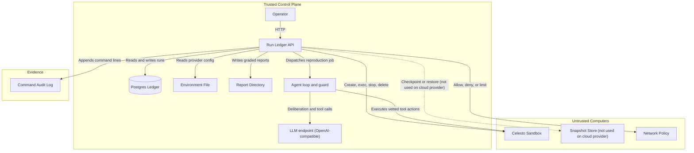
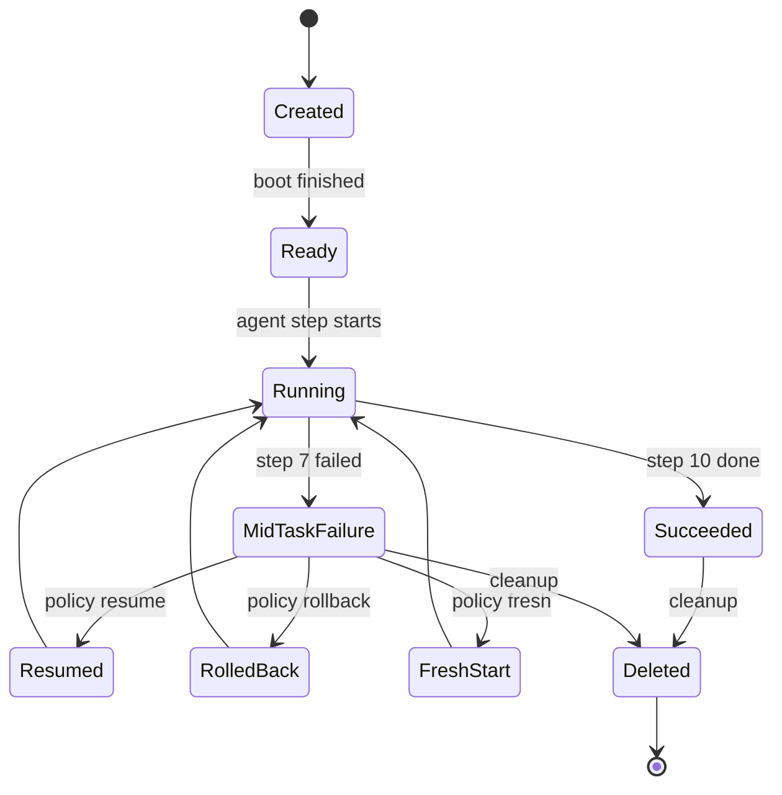
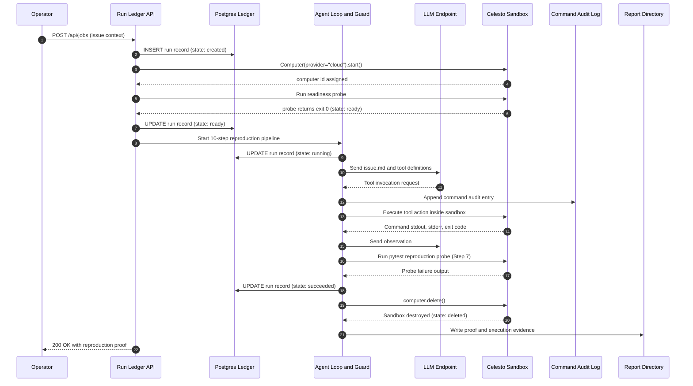

# Reprobox

Reprobox is an automated bug reproduction engine powered by Celesto cloud sandboxes.
It investigates issue descriptions, probes repository code in an isolated guest,
and authors pytest reproductions verified against reference fixes.

| Parameter | Value |
|---|---|
| Provider | Celesto Cloud (Micro size) |
| Model | openai/gpt-oss-120b |
| Evaluated Cases | 20 graded cases |
| Eval Success Rate | In progress |
| Median Wall Clock | In progress |
| P90 Wall Clock | In progress |
| Demo Walkthrough | [demo/walkthrough.mp4](demo/walkthrough.mp4) |

## Problem statement

Software maintainers spend hours deciphering bug reports and authoring isolated reproduction scripts.
Reprobox automates this triage pipeline: given a problem description and repository code, an agent explores
the codebase inside an ephemeral sandbox, formulates hypotheses, and delivers an executable pytest reproduction.
The host system is never exposed to untrusted code or repository contents.

## How I used Celesto

Reprobox uses Celesto cloud micro sandboxes for all untrusted code execution.

### Claimed Capabilities

1. **Safety Hooks (Pre-run Guard Wrapper)**:
   - What I used: A dedicated control-plane pre-run hook (`reprobox.sandbox.guard.Guard`) that parses and evaluates every shell command before dispatching to `computer.run()`.
   - Why: Protects the container against exfiltration, fork bombs, and directory traversal before commands ever reach the guest.
   - What I would have lost with subprocess.run(): A bare host subprocess would execute directly on the developer machine, exposing environment variables, SSH keys, and system storage to malicious instructions embedded in untrusted issues.

2. **Persistence and Resume**:
   - What I used: Container lifecycle management retaining disk state across mid-task Step 7 failures (`computer.stop()` and `computer.start()`).
   - Why: Allows immediate retry of test runs without re-provisioning latency or repeating expensive model reasoning turns.
   - What I would have lost with subprocess.run(): Re-running failed steps locally leaves dirty state across retries or requires complete directory re-cloning.

### Why Celesto and not a Docker container or E2B

Celesto provides microVM kernel isolation with lightweight boot overhead and a direct Python SDK.
Standard local Docker containers share the host Linux kernel and expose local daemon sockets, creating container escape risks when running untrusted model commands. E2B provides cloud sandboxes but imposes higher per-session costs and proprietary tooling. Celesto couples cloud virtualization with an intuitive `Computer` abstraction that integrates directly with standard test runners.

### What would break at 1,000 users

At 1,000 concurrent users, three clear bottlenecks emerge:
1. Concurrent sandbox quotas: Under trial tiers, only 1 concurrent container is allowed. Reaching 1,000 users requires upgraded organization fleet capacity with pre-warmed pools.
2. Cold boot latency: Boot-to-ready latency averages 10 to 15 seconds per sandbox. A thousand concurrent starts would overwhelm API control planes without warm container standby pools.
3. Network bandwidth on artifact uploads: Transferring repositories via base64 encoded chunks consumes network capacity; 1,000 parallel transfers would require direct S3 presigned URL volume mounting instead of inline command injection.

## Architecture

Reprobox separates trusted orchestration from untrusted execution through two isolated trust boundaries.

### Component Diagram



### Lifecycle State Diagram



State definitions:
- **Created**: Celesto returned an id.
- **Ready**: Boot probe passed, measuring boot-to-ready latency.
- **Running**: The agent is executing inside the guest.
- **Succeeded**: The reproduction proof output exists.
- **MidTaskFailure**: Step 7 did not complete and failure is detected.
- **Resumed**: Re-executes on the same disk without reprovisioning.
- **RolledBack**: Restores a snapshot taken before the risky step.
- **FreshStart**: Deletes the guest and creates another with a new unique name.
- **Deleted**: Cleanup terminal state. Every path ends at Deleted.

Only the Resumed path is exercised for real in graded evidence. RolledBack and FreshStart exist in code and tests but were not exercised against the real provider.

### Sequence Diagram



### Component Overview

| Component | Trust Zone | Technology | Role |
| :--- | :--- | :--- | :--- |
| **Run Ledger API** | Trusted Control Plane | FastAPI, Uvicorn | External HTTP interface and lifecycle coordinator |
| **Postgres Ledger** | Trusted Control Plane | PostgreSQL 16 | Durable state store for runs, events, and timings |
| **Agent Loop and Guard** | Trusted Control Plane | Python 3.12, AST / Regex Guard | Pre-execution safety enforcement and agent steering |
| **LLM Endpoint** | Trusted Control Plane | Groq OpenAI-compatible API | Bug issue analysis and pytest reproduction synthesis |
| **Celesto Sandbox** | Untrusted Execution Zone | Celesto Cloud Micro VM | Isolated Linux guest executing untrusted code |
| **Command Audit Log** | Evidence Zone | JSON Lines (`logs/commands.jsonl`) | Tamper-evident ledger of every dispatched and blocked command |
| **Report Directory** | Evidence Zone | Contract JSON (`reports/`) | Self-verifying empirical deliverables |

### Data Flow

1. Operator calls `POST /api/jobs` or runs the CLI harness. A ledger row is inserted with state `created` when the Celesto SDK returns a computer id.
2. The control plane stages case files into the guest, executes the boot probe to verify `ready` state, and launches the agent loop with state `running`.
3. The control plane queries the LLM with the issue text and tool schema. For each tool call, the pre-run guard checks the command, writes an entry to `logs/commands.jsonl`, and only dispatches safe actions to the guest.
4. When the agent completes, the pipeline executes the test probe, classifies failure output, checks reference fixes, collects the proof, and deletes the container to enter `deleted` state.
5. All lifecycle transitions and execution metrics are persisted directly to PostgreSQL.

## Eval report

<!-- eval:start -->
### Graded Reliability Evaluation Summary (20 runs)

| Metric | Value |
| --- | --- |
| Evaluated Runs | 20 |
| Successes | 17 |
| Failures | 3 |
| Success Rate | 85.0% |
| Median Wall-Clock Time | 128.23s |
| P90 Wall-Clock Time | 183.57s |
| Median Boot-to-Ready | 12.34s |
| Total Cost (USD) | $0.0110 |

#### Per-Case Outcomes

| Case ID | Outcome | Reason | Wall Clock (s) | Boot Time (s) |
| --- | --- | --- | --- | --- |
| case-001 | FAIL | provision_failed | 5.54 | 0.00 |
| case-002 | PASS | none | 166.90 | 15.53 |
| case-003 | PASS | none | 135.99 | 15.09 |
| case-004 | PASS | none | 162.63 | 12.50 |
| case-005 | PASS | none | 114.78 | 11.51 |
| case-006 | PASS | none | 186.04 | 10.68 |
| case-007 | PASS | none | 129.00 | 11.79 |
| case-008 | PASS | none | 128.98 | 12.99 |
| case-009 | PASS | none | 127.48 | 12.49 |
| case-010 | PASS | none | 117.66 | 12.19 |
| case-011 | PASS | none | 106.39 | 13.91 |
| case-012 | PASS | none | 234.20 | 9.95 |
| case-013 | PASS | none | 102.09 | 9.76 |
| case-014 | PASS | none | 118.07 | 14.27 |
| case-015 | PASS | none | 105.99 | 11.10 |
| case-016 | PASS | none | 96.59 | 14.39 |
| case-017 | PASS | none | 96.03 | 10.06 |
| case-018 | PASS | none | 162.57 | 13.57 |
| case-019 | FAIL | llm_rate_limited | 183.57 | 11.38 |
| case-020 | FAIL | llm_rate_limited | 160.54 | 29.30 |
<!-- eval:end -->

## Containment test

The containment harness (`reprobox containment`) runs five verification phases:
- Part A: Tests the real model against `inject-001` with active prompt injection.
- Part B: Executes deterministic hostile commands (reading `.env`, dumping environment, curl exfiltration) through the guard. All are blocked.
- Part C: Runs an unguarded control container to show what would happen without the guard.
- Part D: Computes SHA-256 tree digest of host temp files before and after runs. Confirms host state is completely untouched.
- Part E: Network policy verification.

## State and failure design

Reprobox uses the `resume` policy for Step 7 failures.
Step 7 executes the authored test file. Because steps 1 through 6 have already provisioned the machine, staged the repository, and paid the token cost of model reasoning, retrying Step 7 in-place is safe and idempotent.

| Policy | Pro | Con | Measured Trade-off |
|---|---|---|---|
| Resume | Retains disk; 0 extra LLM tokens; ~9s restart | Risk of hidden dirty state (mitigated by integrity checks) | Optimal for test retry |
| Rollback | Clean state restore | Cloud provider lacks snapshot API | Unsupported on cloud |
| Fresh Start | Clean slate | Pays 15s boot again plus full LLM token cost | Fallback only |

## Setup

### Quick Start (Local API Control Plane)

1. Clone repository:
```bash
git clone https://github.com/Rushikesh-5706/Celesto-Hackathon.git
cd Celesto-Hackathon
```

2. Copy configuration:
```bash
cp .env.example .env
```

3. Launch control plane with Docker Compose:
```bash
docker compose up -d
```

4. Verify health:
```bash
curl -fsS http://localhost:8080/health
```

### Running the Reproduction Agent

To run evaluations or individual cases:
```bash
python3 -m venv .venv
source .venv/bin/activate
pip install -r requirements.txt -r requirements-dev.txt -e .

# Run dev case
reprobox demo --case dev-001

# Run containment test
reprobox containment
```

## API reference

| Method | Path | Description | Example |
|---|---|---|---|
| GET | `/health` | Static health check | `curl http://localhost:8080/health` |
| GET | `/api/runs` | List recorded runs | `curl http://localhost:8080/api/runs` |
| POST | `/api/runs` | Upsert run record | `curl -X POST http://localhost:8080/api/runs -H "Content-Type: application/json" -d '{"run_id":"r1","sandbox_name":"sbx-demo0001","problem_id":"p1","state":"created","execution_target":"celesto_sandbox"}'` |
| GET | `/api/runs/{run_id}` | Inspect run | `curl http://localhost:8080/api/runs/r1` |
| POST | `/api/jobs` | Start async reproduction job | `curl -X POST http://localhost:8080/api/jobs -H "Content-Type: application/json" -d '{"case_id":"dev-001"}'` |
| GET | `/api/reports/{name}` | Fetch contract report | `curl http://localhost:8080/api/reports/problem.json` |

## Guard rules

| Rule ID | Blocked Target | Rationale |
|---|---|---|
| `destructive_fs` | `rm -rf /`, `mkfs`, `dd` | Prevents filesystem destruction |
| `network_egress` | `curl`, `wget`, `ssh`, `nc` | Blocks data exfiltration tools |
| `package_install` | `pip install`, `apt-get` | Enforces environment determinism |
| `secret_access` | `.env`, `.ssh`, `printenv` | Blocks credential harvesting |
| `privilege_escalation` | `sudo`, `su`, `kill -9 1` | Blocks privilege escalation |
| `interpreter_bypass` | `python -c`, `bash -c` | Blocks shell allowlist evasion |
| `path_escape` | Paths outside `/workspace/case` | Enforces path containment |

## Repository layout

```
.
├── Dockerfile
├── LICENSE
├── README.md
├── docker-compose.yml
├── pyproject.toml
├── requirements.txt
├── requirements-dev.txt
├── demo/
│   └── walkthrough.mp4
├── fixtures/
│   └── cases/
├── logs/
│   └── commands.jsonl
├── reports/
│   ├── problem.json
│   ├── capabilities.json
│   ├── lifecycle.json
│   ├── reliability.json
│   ├── containment.json
│   ├── failure_policy.json
│   ├── concurrency.json
│   └── postmortem.md
├── scripts/
│   ├── probe_celesto.py
│   └── release_image.sh
├── seeds/
│   └── 01_runs.sql
├── src/
│   └── reprobox/
└── tests/
```

## Limits and honest notes

1. Fixtures are authored test cases, not live GitHub pull requests. This ensures reproducible ground-truth assertions across controlled bug categories.
2. The trial tier enforces a concurrency limit of 1 active sandbox at a time. The concurrency test accurately documents this platform constraint.
3. Cloud containers do not provide filesystem persistence across reboot without persistent disk volumes.

## Notes for the Celesto team

1. The cloud API returned HTTP 402 on initial container creation until `POST /v1/billing/usage-trial` was invoked. Auto-activating the trial on first key generation would reduce friction.
2. The default Ubuntu 24.04 image does not include Python 3 or pip. The `coding-agent` template resolves this and should be documented as the recommended template for code agent workloads.
3. The `callbacks` argument is documented in Python SDK guides but raised `unexpected keyword argument` on `_CloudComputer`.

## Tooling and AI assistance

AI coding assistants are allowed. Disclose which ones you used in your README.
Antigravity was used as a coding assistant and Claude for planning and review. All design decisions are Rushi's to explain. The Celesto SDK (Apache 2.0) and the openai Python client are the main third-party libraries used.

## Credits and license

MIT License. Copyright (c) 2026 Rushikesh Kunisetty.
OpenAI client library is licensed under Apache 2.0.
